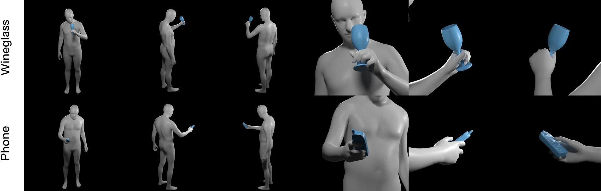

# Tri-DNO

Official Repository for **Tri-DNO: Trilateral Diffusion Noise Optimization for
3D Human Object Interaction** (CVMP 2026), by Paul Hinzer, Niklas Gard, Anna Hilsmann, and
Peter Eisert.

The Code is to be released soon. For now, this repository only holds the project website.
